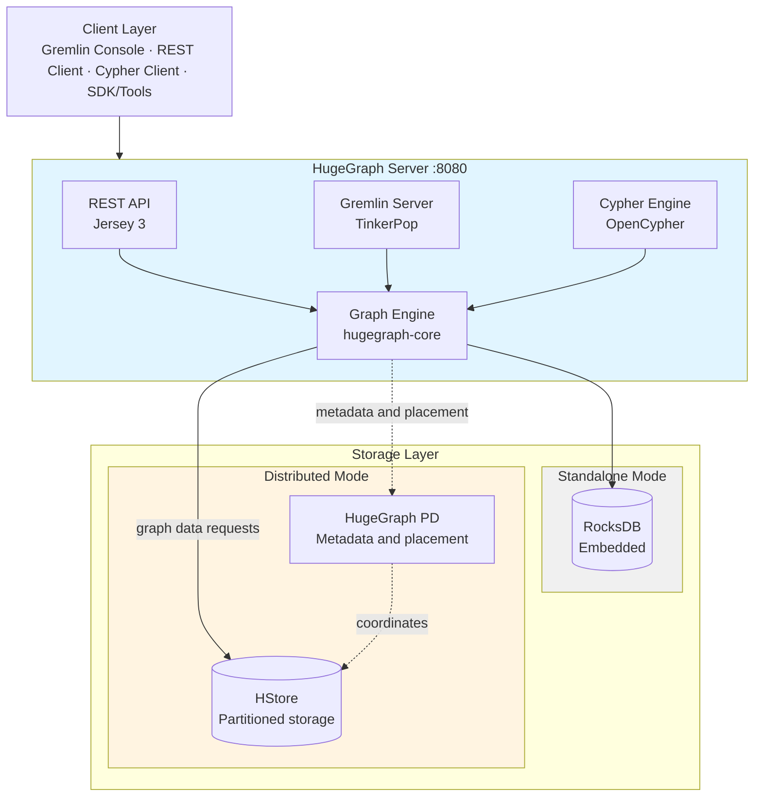

<h1 align="center">
    
</h1>

<h3 align="center">A graph database that supports more than 10 billion vertices & edges, high performance and scalability</h3>

<div align="center">

[](https://www.apache.org/licenses/LICENSE-2.0.html)
[](https://github.com/apache/hugegraph/actions/workflows/server-ci.yml)
[](https://github.com/apache/hugegraph/actions/workflows/pd-store-ci.yml)
[](https://github.com/apache/hugegraph/releases)
[](https://artifacthub.io/packages/helm/hugegraph-helm/hugegraph-helm)
[](https://deepwiki.com/apache/hugegraph)

</div>

---

**Quick Navigation:** [Architecture](#architecture) • [Quick Start](#quick-start) • [Module Map](#module-map) • [Documentation](#documentation) • [Ecosystem](#ecosystem) • [For Contributors](#contributing) • [Community](#community)

---

## What is Apache HugeGraph?

[HugeGraph](https://hugegraph.apache.org/) is a fast and highly-scalable [graph database](https://en.wikipedia.org/wiki/Graph_database).
Billions of vertices and edges can be easily stored into and queried from HugeGraph due to its excellent OLTP capabilities.
HugeGraph is compliant with the [Apache TinkerPop 3](https://tinkerpop.apache.org/) framework allowing complicated graph queries to be
achieved through the powerful [Gremlin](https://tinkerpop.apache.org/gremlin.html) graph traversal language.

## Features

- **Schema Metadata Management**: VertexLabel, EdgeLabel, PropertyKey, and IndexLabel
- **Multi-type Indexes**: Exact query, range query, and complex conditions combination query
- **Plug-in Backend Store Framework**: RocksDB powers standalone deployments and HStore powers distributed clusters. See the [backend evolution guide](hugegraph-server/README.md#backend-evolution-and-compatibility) for compatibility details.
- **Backend Compatibility**: HBase is deprecated but remains supported; see the [backend evolution guide](hugegraph-server/README.md#backend-evolution-and-compatibility).
- **Big Data Integration**: Seamless integration with `Flink`/`Spark`/`HDFS`
- **Complete Graph Ecosystem**: In/out-memory Graph Computing + Graph Visualization & Tools + Graph Learning & AI
- **Dual Query Language Support**: [Gremlin](https://tinkerpop.apache.org/gremlin.html) (via [Apache TinkerPop 3](https://tinkerpop.apache.org/)) and [Cypher](https://en.wikipedia.org/wiki/Cypher_(query_language)) (OpenCypher)

## Quick Start

### 5 Minutes Quick Start

Start a standalone server for local evaluation, bind it to the loopback interface and wait until a Gremlin query succeeds before continuing:

```bash
(
  docker run -d --name hugegraph \
    -p 127.0.0.1:8080:8080 hugegraph/hugegraph || exit 1

  for attempt in $(seq 1 60); do
    if curl -fsS --max-time 2 -o /dev/null \
      -X POST http://127.0.0.1:8080/gremlin \
      -H 'Content-Type: application/json' \
      -d '{"gremlin":"g.V().limit(1)"}'; then
      exit 0
    fi
    if [ "${attempt}" -eq 60 ]; then
      printf 'Server query did not become ready; inspect the logs before continuing.\n' >&2
      docker logs hugegraph
      exit 1
    fi
    sleep 2
  done
)
```

After the readiness query succeeds, run a small graph query:

```bash
curl -X POST http://127.0.0.1:8080/gremlin \
  -H 'Content-Type: application/json' \
  -d '{"gremlin":"g.V().limit(5)"}'
```

A timeout deliberately leaves the named container available for diagnosis. Inspect `docker logs hugegraph` and preserve any required data or attached volumes first. When it is safe to discard the failed container, stop and remove it before retrying:

```bash
docker stop hugegraph 2>/dev/null || true
docker rm hugegraph
```

The loopback bind keeps this evaluation endpoint off ordinary remote interfaces while authentication is not enabled. Users of older Docker or unusual host-network setups should also restrict host firewall access explicitly. Pin a released image for repeatable deployments and enable authentication before exposing the service outside a trusted network. See the [server deployment guide](https://hugegraph.apache.org/docs/quickstart/hugegraph-server/) for packages, configuration and production preparation.

## Ecosystem

Complete **HugeGraph** ecosystem components:

1. **[hugegraph-toolchain](https://github.com/apache/hugegraph-toolchain)** - Graph tools suite
   - [Loader](https://github.com/apache/hugegraph-toolchain/tree/master/hugegraph-loader) - Data import tool
   - [Dashboard](https://github.com/apache/hugegraph-toolchain/tree/master/hugegraph-hubble) - Web visualization platform
   - [Tool](https://github.com/apache/hugegraph-toolchain/tree/master/hugegraph-tools) - Command-line utilities
   - [Client](https://github.com/apache/hugegraph-toolchain/tree/master/hugegraph-client) - Java/Python client SDK

2. **[hugegraph-computer](https://github.com/apache/hugegraph-computer)** - Integrated **graph computing** system

3. **[hugegraph-ai](https://github.com/apache/hugegraph-ai)** - **Graph AI/LLM/Knowledge Graph** integration

4. **[hugegraph-doc](https://github.com/apache/hugegraph-doc)** - **Documentation & website** repository

## Architecture

HugeGraph supports both **standalone** and **distributed** deployments:




<details>
<summary><b>Text architecture diagram</b></summary>

```
                        ┌─────────────────────────────────────────────────────┐
                        │                    Client Layer                     │
                        │  Gremlin Console │ REST Client │ Cypher │ SDK/Tools │
                        └─────────────────────────┬───────────────────────────┘
                                                  │
                        ┌─────────────────────────▼───────────────────────────┐
                        │             HugeGraph Server (:8080)                │
                        │  ┌──────────┐  ┌──────────┐  ┌──────────────────┐   │
                        │  │ REST API │  │ Gremlin  │  │   Cypher Engine  │   │
                        │  │(Jersey 3)│  │TinkerPop │  │   (OpenCypher)   │   │
                        │  └────┬─────┘  └────┬─────┘  └────────┬─────────┘   │
                        │       └─────────────┼─────────────────┘             │
                        │            ┌────────▼────────┐                      │
                        │            │  Graph Engine   │                      │
                        │            │(hugegraph-core) │                      │
                        │            └────────┬────────┘                      │
                        └─────────────────────┼───────────────────────────────┘
                                              │
                            ┌─────────────────┴─────────────────┐
                            │                                   │
             ┌──────────────▼──────────────┐     ┌──────────────▼──────────────┐
             │        Standalone Mode      │     │       Distributed Mode      │
             │  ┌───────────────────────┐  │     │  ┌───────────────────────┐  │
             │  │        RocksDB        │  │     │  │     HugeGraph-PD      │  │
             │  │      (embedded)       │  │     │  │   (Raft, 3-5 nodes)   │  │
             │  └───────────────────────┘  │     │  │      :8620/:8686      │  │
             │                             │     │  └───────────┬───────────┘  │
             │  Use Case:                  │     │  coordinates │              │
             │  Development/Testing        │     │  ┌───────────▼───────────┐  │
             │  Single Node                │     │  │         HStore        │  │
             │                             │     │  │    (Raft, 3+ nodes)   │  │
             │  Single-node storage        │     │  │         :8520         │  │
             └─────────────────────────────┘     │  └───────────────────────┘  │
                                                 │                             │
                                                 │  Use Case:                  │
                                                 │  Production/HA/Cluster      │
                                                 │                             │
                                                 │  Horizontal scaling         │
                                                 └─────────────────────────────┘
```

</details>

In distributed mode, Server asks PD for metadata and placement, then sends graph data requests directly to HStore; PD coordinates the storage nodes and does not forward graph data.

See the [backend evolution guide](hugegraph-server/README.md#backend-evolution-and-compatibility) for lifecycle and historical compatibility guidance.

To use ToplingDB with the RocksDB backend, follow the [three-step switching guide](docs/storage-lifecycle.md#storage-provider-selection-and-toplingdb).

### Deployment Mode Comparison

| Mode | Components | Use Case | Scaling | High Availability |
|------|------------|----------|---------|-------------------|
| **Standalone** | Server + RocksDB | Development, Testing, Single Node | Single node | Basic |
| **Distributed** | Server + PD + HStore | Production, HA, Horizontal Scaling | Horizontal scaling | Yes |

Actual capacity depends on hardware, data and workload.

### Module Overview

| Module | Description |
|--------|-------------|
| [hugegraph-server](hugegraph-server) | Core graph engine with REST API, Gremlin/Cypher support, and pluggable backends (RocksDB default) |
| [hugegraph-pd](hugegraph-pd/README.md) | Placement Driver for distributed mode - handles meta storage, partition management and cluster scheduling |
| [hugegraph-store](hugegraph-store/README.md) | Distributed storage with Raft consensus for high availability and horizontal scaling |
| [hugegraph-commons](hugegraph-commons) | Shared utilities, RPC framework and common components |
| [hugegraph-struct](hugegraph-struct/README.md) | Shared schema, IDs, base elements, queries and encoding used by Server and Store |

See the [1.8.0 shared-foundation migration guide](docs/shared-foundation-migration.md) for Java API changes, module ownership and coordinated upgrade requirements.


## Installation

<!-- TODO: update release downloads, package names, image tags and version examples after 1.8.0 is published. -->

### Prerequisites

- **Java 17** (required and currently the only supported Java release)
- **Maven 3.6.3+** (for building from source)

The launch scripts reject Java versions older than 17. That minimum-version
check does not qualify later Java releases; use Java 17 unless another release
is explicitly listed as supported.

Read the [Server runtime guide](docs/server-runtime.md#runtime-and-client-configuration)
for client configuration and query compatibility checks.

### Option 1: Docker (Fastest)

Docker is the quickest way to get started for **testing or development**. Each command below is an alternative; remove or rename an existing `hugegraph` container before trying another. The loopback port binding is for local use:

```bash
# Basic usage
docker run -itd --name=hugegraph -p 127.0.0.1:8080:8080 hugegraph/hugegraph:1.7.0

# With sample graph preloaded
docker run -itd --name=hugegraph -e PRELOAD=true -p 127.0.0.1:8080:8080 hugegraph/hugegraph:1.7.0

# With authentication enabled
docker run -itd --name=hugegraph -e PASSWORD=your_password -p 127.0.0.1:8080:8080 hugegraph/hugegraph:1.7.0
```

For advanced Docker configurations, see:

* [Docker Documentation](https://hugegraph.apache.org/docs/quickstart/hugegraph-server/#3-deploy)
* [Docker Compose Examples](./docker/)
* [Docker README](./docker/README.md)
* [Server Docker README](hugegraph-server/hugegraph-dist/docker/README.md)

> **Docker Desktop (Mac/Windows)**: The 3-node distributed cluster (`docker/docker-compose-3pd-3store-3server.yml`) uses Docker bridge networking and works on all platforms including Docker Desktop. Allocate at least 12 GB memory to Docker Desktop.

> **Note**: Docker images are convenience releases, not **official ASF distribution artifacts**. See [ASF Release Distribution Policy](https://infra.apache.org/release-distribution.html#dockerhub) for details.
>
> **Version Tags**: Use release tags (e.g., `1.7.0`) for stable deployments. The `latest` tag should only be used for testing or development.

### Option 2: Kubernetes with Helm

The HStore Helm chart deploys HugeGraph PD, Store, and Server as a distributed
Kubernetes cluster. See the [chart documentation](helm/hugegraph/README.md) for
single-node and highly available presets, configuration, and
upgrade guidance.


<details>
<summary><b>Option 3: Download Binary Package</b></summary>

Download pre-built packages from the [Download Page](https://hugegraph.apache.org/docs/download/download/). Replace `{version}` below with the version of the package you choose:

```bash
# Download and extract
# For historical 1.7.0 and earlier releases, use the archive URL and
# set PACKAGE=apache-hugegraph-incubating-{version} instead.
BASE_URL="https://downloads.apache.org/hugegraph/{version}"
PACKAGE="apache-hugegraph-{version}"
# Historical alternative:
# BASE_URL="https://archive.apache.org/dist/incubator/hugegraph/{version}"
# PACKAGE="apache-hugegraph-incubating-{version}"

wget ${BASE_URL}/${PACKAGE}.tar.gz
tar -xzf ${PACKAGE}.tar.gz
cd ${PACKAGE}

# Initialize backend storage
bin/init-store.sh

# Start server
bin/start-hugegraph.sh

# Check server status
bin/monitor-hugegraph.sh
```

For detailed instructions, see the [Binary Installation Guide](https://hugegraph.apache.org/docs/quickstart/hugegraph-server/#32-download-the-binary-tar-tarball).

</details>

<details>
<summary><b>Option 4: Build from Source</b></summary>

Build from source for development or customization:

```bash
# Clone repository
git clone https://github.com/apache/hugegraph.git
cd hugegraph

# Build all modules (skip tests for faster build)
mvn clean package -DskipTests

# Replace VERSION with the project version from pom.xml before extracting
VERSION="<project-version>"
tar -xzf "hugegraph-server/apache-hugegraph-server-${VERSION}.tar.gz"
cd "apache-hugegraph-server-${VERSION}"

# Initialize and start
bin/init-store.sh
bin/start-hugegraph.sh
```

For detailed build instructions, see [BUILDING.md](docs/BUILDING.md) and [Build from Source Guide](https://hugegraph.apache.org/docs/quickstart/hugegraph-server/#33-source-code-compilation).

</details>

<details>
<summary><b>Verify Installation</b></summary>

Once the server is running, verify the installation:

```bash
# Check server version
curl http://localhost:8080/versions

# The response reports the installed server and Gremlin versions.

# Try Gremlin console (if installed locally)
bin/gremlin-console.sh
```

In the Gremlin console:

```text
gremlin> :remote connect tinkerpop.server conf/remote.yaml
gremlin> :> g.V().limit(5)
```

For comprehensive documentation, visit the [HugeGraph Documentation](https://hugegraph.apache.org/docs/).

Read the [storage lifecycle and recovery guide](docs/storage-lifecycle.md) before restoring data, mounting store directories or upgrading the storage runtime.

</details>

## Module Map

<details>
<summary><b>Developer navigation</b></summary>

**Developer Navigation**: Find the right module for your task

| I want to... | Module | Key Path |
|--------------|--------|----------|
| Understand graph operations | `hugegraph-core` | `StandardHugeGraph.java` |
| Modify REST APIs | `hugegraph-api` | `src/.../api/` |
| Add storage backend | `hugegraph-core` | `BackendStore.java` |
| Develop Gremlin features | `hugegraph-core` | `src/.../traversal/` |
| Develop Cypher features | `hugegraph-api` | `src/.../opencypher/` |
| Work on distributed coordination | `hugegraph-pd` | `hg-pd-core/` |
| Work on distributed storage | `hugegraph-store` | `hg-store-core/` |
| Add backend implementations | `hugegraph-server/hugegraph-{backend}` | `hugegraph-rocksdb/`, `hugegraph-hstore/` |
| Understand configuration | `hugegraph-dist` | `src/assembly/static/conf/` |
| Run tests | `hugegraph-test` | Test suites with multiple profiles |

For repository constraints and module guidance, see [AGENTS.md](AGENTS.md).

</details>

<details>
<summary><b>For Contributors</b></summary>

**New to HugeGraph?** Follow this path to get started:

1. **Understand the Architecture**
   - Read [AGENTS.md](AGENTS.md) for key component relationships and module guidance
   - Review the [Architecture Diagram](#architecture) above

2. **Set Up Your Environment**
   - Install Java 17 and Maven 3.6.3+
   - Follow [BUILDING.md](docs/BUILDING.md) for build instructions
   - Configure your IDE to use `.editorconfig` for code style and `style/checkstyle.xml` for Checkstyle rules

3. **Find Your First Issue**
   - Browse [Good First Issues](https://github.com/apache/hugegraph/issues?q=label%3A%22good+first+issue%22)
   - Check [Help Wanted Issues](https://github.com/apache/hugegraph/issues?q=label%3A%22help+wanted%22)

4. **Learn the Codebase**
   - Use the [Module Map](#module-map) to navigate
   - Try [DeepWiki](https://deepwiki.com/apache/hugegraph) for AI-powered codebase understanding
   - Run tests to understand behavior: `mvn test -pl hugegraph-server/hugegraph-test -am -P core-test,memory`
   - Try modifying a test and see what breaks

5. **Code Standards**
   - Line length: 120 characters
   - Indentation: 4 spaces
   - No star imports
   - Commit format: `feat|fix|refactor(module): description`

6. **Submit Your Contribution**
   - Read [CONTRIBUTING.md](docs/CONTRIBUTING.md) for guidelines
   - Follow the [Contribution Guidelines](https://hugegraph.apache.org/docs/contribution-guidelines/)
   - Use [GitHub Desktop](https://desktop.github.com/) to simplify the PR process

</details>

## Documentation

- [Repository documentation index](docs/README.md): build, API, runtime, storage and internal design guides.
- [Official HugeGraph documentation](https://hugegraph.apache.org/docs/): user guides and released-product instructions.
- [Helm documentation index](helm/hugegraph/docs/README.md): Kubernetes installation, operations and optional components.

## Contributing

Welcome to contribute to HugeGraph!

- **How to Contribute**: See [CONTRIBUTING.md](docs/CONTRIBUTING.md) and [Contribution Guidelines](https://hugegraph.apache.org/docs/contribution-guidelines/)
- **Code Style**: Configure your IDE to use `.editorconfig` for code style and `style/checkstyle.xml` for Checkstyle rules
- **PR Tool**: [GitHub Desktop](https://desktop.github.com/) is recommended for simpler workflow

Thank you to all the contributors who have helped make HugeGraph better!

[](https://github.com/apache/hugegraph/graphs/contributors)

## License

HugeGraph is licensed under [Apache 2.0 License](LICENSE).

## Community

**Get Help & Stay Connected**

- **[GitHub Issues](https://github.com/apache/hugegraph/issues)**: Report bugs and request features (quick response)
- **Mailing List**: [dev@hugegraph.apache.org](mailto:dev@hugegraph.apache.org) ([subscribe here](https://hugegraph.apache.org/docs/contribution-guidelines/subscribe/))
- **Slack**: [ASF HugeGraph Channel](https://the-asf.slack.com/archives/C059UU2FJ23)
- **WeChat**: Scan the QR code to follow Apache HugeGraph official account

<p align="center">

</p>

## Thanks

HugeGraph relies on the [Apache TinkerPop](http://tinkerpop.apache.org) framework. We are grateful to the TinkerPop community, Titan, and DataStax for their foundational work. Thanks to all contributors and organizations who have helped make HugeGraph possible.

You are welcome to contribute to HugeGraph, and we look forward to working with you to build an excellent open-source community.