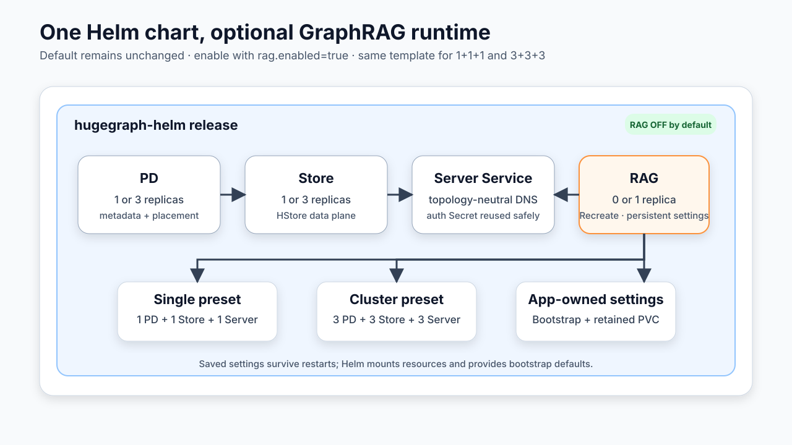

# Optional HugeGraph RAG deployment

The main HugeGraph chart owns the Kubernetes topology for the whole system.
`rag.enabled=true` adds the `hugegraph/rag` application from
[hugegraph-ai](https://github.com/apache/hugegraph-ai) without changing the
PD, Store, Server or Hubble topology. The component remains disabled by
default, and the Docker image and Docker Compose workflows in hugegraph-ai
remain independent.



## Enable it

The same RAG template works with both presets because it connects through the
release-scoped Server Service rather than enumerating Server Pods. The optional
`values-rag.yaml` overlay is the complete, reviewable profile; `rag.enabled=false`
removes every RAG object again. A bare `--set rag.enabled=true` also renders with
safe template defaults, while the overlay adds the recommended non-root and
resource settings.

```bash
# Single PD + Store + Server, plus one RAG Pod
helm upgrade --install hugegraph ./helm/hugegraph \
  -n hugegraph --create-namespace \
  -f helm/hugegraph/values-single.yaml \
  -f helm/hugegraph/values-rag.yaml

# 3 + 3 + 3 HugeGraph cluster, plus the preset's RAG replica count
helm upgrade --install hugegraph ./helm/hugegraph \
  -n hugegraph --create-namespace \
  -f helm/hugegraph/values-cluster.yaml \
  -f helm/hugegraph/values-rag.yaml
```

With `rag.hugegraph.autoConfigure=true` and an empty `rag.hugegraph.url`, the
chart injects:

- `GRAPH_URL` as the same-release Server client Service in the application's native `host:port` form;
- `GRAPH_NAME`, `GRAPH_SPACE` and `GRAPH_USER` from chart values;
- `GRAPH_PWD` from the same Server administrator Secret when Server auth is
  enabled; and
- a writable `HUGEGRAPH_LLM_ENV_PATH` under `/tmp`.

The chart starts the application's native module explicitly and passes
`rag.port` to its `--port` argument. The container port, Service and probes use
the same resolved value.

Any entry in `rag.env` with the same name replaces its automatic counterpart.
Set `rag.hugegraph.autoConfigure=false` to manage the complete application
environment yourself.

## Model provider credentials

Keep provider credentials out of values files. Create a Secret and expose it
with `envFrom`:

```bash
kubectl -n hugegraph create secret generic rag-model \
  --from-literal=OPENAI_API_KEY='replace-me' \
  --from-literal=OPENAI_EMBEDDING_API_KEY='replace-me'

cat > /tmp/rag-values.yaml <<'YAML'
rag:
  enabled: true
  envFrom:
    - secretRef:
        name: rag-model
YAML

helm upgrade --install hugegraph ./helm/hugegraph \
  -n hugegraph --create-namespace -f /tmp/rag-values.yaml
```

The application supports other model providers through the same native
`env`/`envFrom` mechanism. The chart does not copy credentials into a
ConfigMap or a generated Secret.

## Use another HugeGraph deployment

Set an explicit URL and credential Secret. An external URL disables automatic
reuse of this release's Server password.

```yaml
rag:
  enabled: true
  hugegraph:
    autoConfigure: true
    url: http://hugegraph-server.graphs.svc:8080
    graphName: hugegraph
    graphSpace: DEFAULT
    username: admin
    passwordSecret:
      name: external-hugegraph-admin
      key: password
```

## Exposure and authentication

The RAG Service defaults to `ClusterIP` in both `easy` and `strict` modes. This
is intentionally stricter than the browser-oriented Server and Hubble defaults:
the current RAG application starts with login disabled and warns that binding to
a non-loopback address does not provide unified authentication for every HTTP
API route.

An explicit `rag.service.type` always wins. Ingress remains disabled until
`rag.ingress.enabled=true`. Treat NodePort, LoadBalancer and Ingress as reviewed
external-exposure choices. Put the application behind an authenticated reverse
proxy or another trusted network boundary and apply model-provider spend limits.
The application's native login can still be enabled for its own UI and guarded
write paths, but it is not a substitute for an authenticated ingress protecting
all routes:

```bash
kubectl -n hugegraph create secret generic rag-login \
  --from-literal=USER_TOKEN='replace-user-token' \
  --from-literal=ADMIN_TOKEN='replace-admin-token'
```

```yaml
rag:
  enabled: true
  env:
    - name: ENABLE_LOGIN
      value: "True"
  envFrom:
    - secretRef:
        name: rag-login
  service:
    type: NodePort
```

In `mode=strict`, a NetworkPolicy isolates the Pod. Strict mode permits DNS and
the same-release Server automatically, but does not silently open access to
public model APIs or an Ingress controller. Add the required peers to
`rag.networkPolicy.extraIngress` and provider destinations to
`rag.networkPolicy.extraEgress` using native Kubernetes NetworkPolicy rules.

## Persistence and replicas

Persistence is off by default, so the image's packaged prompt and resource
files are not hidden by an empty volume. When enabled, an init container seeds
the claim from the selected image before the main container mounts it at
`rag.persistence.mountPath`. A generated claim is retained on uninstall.

One generated `ReadWriteOnce` claim is valid only for one RAG replica. For
multiple replicas, either keep persistence disabled, provide an existing
shared claim, or use a StorageClass that supports `ReadWriteMany` and include
that mode in `rag.persistence.accessModes`. Model and graph credentials remain
Kubernetes Secrets regardless of persistence.
